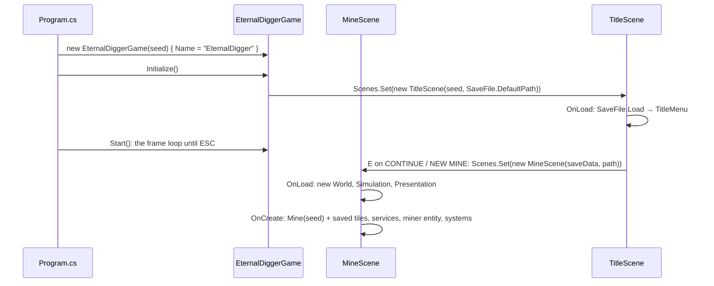

# Architecture: how EternalDigger uses the engine

EternalDigger is built only on the engine's ECS (`ConsoleEngine.Ecs`); there is no object-oriented version of it. This
page walks from the engine's entry points down to a single frame, and explains which parts are entities and which are
not.

## The layers

```text
Program.cs                       parses the seed, creates the game, Initialize(), Start()
└── EternalDiggerGame : GameBase  120 × 48 cells, 8 × 16 font; ESC → MineScene.Save(), Stop()
    ├── TitleScene : Scene<EternalDiggerGame>   loads the save; CONTINUE / NEW MINE (TitleMenu)
    └── MineScene : EcsScene<EternalDiggerGame>  started from a SaveData (loaded, or SaveData.NewMine)
        ├── shared services       Mine, Elevator, Random, EffectSpawner (+ ScreenShake), LightMap, Canvas, GameSaver
        ├── World                 the miner, particles, floating texts
        ├── World                 (also) planted dynamite
        ├── Simulation group      13 systems: rules, motion, lift, dynamite, camera, light, effects, saving
        └── Presentation group    10 systems: sky, terrain, house, lift, dynamite, particles, miner, texts, prompts, HUD
```

| Engine piece | Used for | Where |
|---|---|---|
| `GameBase` | The window, the frame loop, save and `Stop()` on `ESC` | `EternalDiggerGame.cs` |
| `SceneManager.Set` | Loads the title, then the mine | `EternalDiggerGame.OnInitialize`, `TitleScene.OnUpdate` |
| `EcsScene<TGame>` | Owns the `World`, the two `SystemGroup`s and the `Camera`; disposes the world on unload | `Scenes/MineScene.cs` |
| `World`, `Query`, `EntityChunk` | Entity storage and chunk-by-chunk iteration | every system |
| `EntitySystem` + `Commands` | Game logic; structural changes (spawning and destroying particles) through the group's `CommandBuffer` | `Systems/` |
| `Position`, `Velocity`, `Glyph` | Built-in components, reused instead of game copies | miner, particles, numbers |
| `Camera` | Which world cell is in the top-left screen cell | `CameraSystem` writes it, every renderer reads it |
| `RenderConsole` | The frame buffer, reached through the game's `Canvas` | `Rendering/Canvas.cs` |
| `Input.Instance` | Key states (`Held`, `Pressed`) | `MinerInput.FromKeyboard` (also `E`: `Use`, `UsePressed`, read by `InteractionSystem` too) |

Not used: the engine's `MovementSystem` (particles move in `ParticlePhysicsSystem` together with gravity and
collisions), `GlyphRenderSystem` (it paints a background behind each glyph; the game wants to keep the background),
`SpriteRenderSystem`/`OutlineRenderSystem`, `IForEach` jobs (the systems use chunk loops; see
[Iterating](#iterating)), `[UpdateBefore]`/`[UpdateAfter]` (the order of `Add` calls is the run order), the logger.

## Startup



`MineScene.OnCreate` builds everything once:

1. **Shared services**, plain objects (not ECS data) handed to the systems through their constructors:
   - `Mine(seed)`, the world grid ([below](#the-mine-is-not-made-of-entities)), with the save's changed tiles put back
     (`SaveData.ApplyTo`).
   - `Elevator`, the lift in the shaft: segments, the car and its landings, restored from the save.
   - `Random(seed)`, one random source for every effect.
   - `EffectSpawner(random, new ScreenShake())`, which creates particles ([rendering-and-effects.md](rendering-and-effects.md)).
   - `LightMap(30, 26)`, the light for the tile rows on screen.
   - `Canvas(Console)`, the frame buffer wrapper that remembers backgrounds.
   - `GameSaver(path, seed, mine)`, which writes the save ([Saving](#saving)).
2. **The miner entity**: `Position` (top-left cell of the sprite, in world cells) and `Miner` (grid position,
   motion, inventory), from `SaveData.ToMiner`.
3. **The systems**, in run order.

The engine has no singletons or resources for ECS data, so services shared by several systems are passed to their
constructors. Each system is a small `sealed` class with a primary constructor, like the engine's own examples.

## The mine is not made of entities

The terrain is the biggest thing in the game and it is **not** in the `World`. `Mine` (`Mining/Mine.cs`) is a flat
`TileCell[]` array, 30 cells per row, 4 bytes per cell (`Type`, `Damage`, `HasLadder`, `Seen`).

Why a grid and not one entity per tile:

- Lookups are by position (what's below the miner? is this particle inside rock?), which a grid answers in O(1).
- The mine is endless. A grid only grows when deeper rows are touched (64 rows at a time, `Mine.RowsPerBlock`); 1 km
  of mine is about 120 KB. Entities for every tile would grow the world forever, and every query would walk them.
- Only the rows on screen are drawn, by `TerrainRenderSystem`, straight from the grid.

| Data | Lives in | Why |
|---|---|---|
| Tiles, ladders, damage, "seen" | `Mine` grid | Position lookups, endless size |
| Per-frame light | `LightMap` (`byte` per on-screen tile) | Recomputed every frame |
| The miner | Entity: `Position` + `Miner` | Moves, has state, drawn and queried by several systems |
| Particles | Entities: `Position`, `Velocity`, `Glyph`, `Particle`, `Physics` (+ `TileCollider` or `Mist`) | Hundreds at a time, short-lived, iterated in bulk |
| Floating texts | Entities: `Position`, `Velocity`, `FloatingText` | Short-lived |
| Planted dynamite | Entities: `Position`, `Dynamite` | A few at a time, burn down and go off |
| Rules (prices, hits, depths) | `const`s on static classes: `Tiles`, `Shop`, `Layout` | Shared, testable, no state |
| The lift | `Elevator` service (segments, car row, call) | One of it; rules testable without a `World` |

### Archetypes in play

Because components are grouped by their exact set, the world holds six archetypes:

| Archetype | Created by |
|---|---|
| `Position, Miner` | `MineScene.CreateMiner` |
| `Position, Velocity, Glyph, Particle, Physics` | `EffectSpawner` (dust, sparks, pops, glints) |
| … + `TileCollider` | `EffectSpawner` (debris chunks, coins) |
| … + `Mist` | `EffectSpawner.Mist` |
| `Position, Velocity, FloatingText` | `EffectSpawner.Number`, `EffectSpawner.Text` |
| `Position, Dynamite` | `EffectSpawner.PlantDynamite` |

Systems pick the parts they need with queries, for example `Query.With<Particle, Position, Velocity>().With<Physics>()`
matches all three particle archetypes, and `chunk.Has<TileCollider>()` tells a chunk loop whether to run collisions.

## One frame

The engine's loop (`GameBase.Start`) runs: `GameTime.Update` → `Input.Instance.Update` → clear the frame buffer →
`Scenes.Update` → `OnUpdate` → `Scenes.Render` → `OnRender` → `Display` (one write to the console). In
EternalDigger that becomes:

```text
Scenes.Update → MineScene.OnUpdate → Simulation.Update(dt)
  MinerControlSystem      MinerInput.FromKeyboard(); rescue, ride keys in the lift, fall, ladder, walk or dig
                            → Mine.Hit / TryPlaceLadder / Elevator.Send, effects recorded in Commands
  InteractionSystem       E at the door/shop/lift sign/landing → Deliver / TryBuyLadder / Elevator.TryBuild / call
  MinerMotionSystem       slide Position one tile, finish moves, foot and landing dust
  ElevatorSystem          move the car; carry the rider; a called car picks up the caller
  DynamiteSystem          burn fuses (sparks, smoke); blast: clear 3 × 3, bag ore, push the miner, chain
  CameraSystem            follow the miner, add shake, round to whole cells → Camera.Position
  LightingSystem          LightMap.Compute for the rows on screen (marks tiles Seen)
  GlintSystem             sample ore near the miner → glints
  MistSystem              keep up to 40 mist particles in lit caves
  ParticlePhysicsSystem   gravity, drag, move, land on rock
  ParticleLifetimeSystem  age, pick the glyph for the age, destroy expired
  FloatingTextSystem      drift up, destroy expired
  SaveSystem              a sale/purchase asked for a save, or 60 s underground → GameSaver.Save
  ── Commands.Playback: the particles recorded above are created, expired ones destroyed
OnUpdate (game)           ESC → MineScene.Save(), Stop()
Scenes.Render → MineScene.OnRender → Presentation.Update(dt)
  SkyRenderSystem → TerrainRenderSystem → HouseRenderSystem → ElevatorRenderSystem → DynamiteRenderSystem
  → ParticleRenderSystem
  → MinerRenderSystem → FloatingTextRenderSystem → PromptRenderSystem → HudSystem
Display                   the frame goes to the console in one write
```

Order matters in a few places:

- **Control before motion.** `MinerControlSystem` starts a move by setting `Column`/`Row` to the target tile and
  `MoveFrom` to the old one; `MinerMotionSystem` slides the `Position` there in the same frame. When a move ends, the
  next frame's control step can start the next one right away, so falls chain without pauses.
- **Camera before lighting and rendering.** The light is computed for exactly the rows the camera shows.
- **Effects appear in the frame they are made.** Particles are recorded in the Simulation group's `CommandBuffer` and
  created at its playback, before Presentation draws. Their first frame skips physics and the lifetime step, so
  `EffectSpawner` gives each one its first look (`ParticleLooks.GlyphAt` at progress 0) when it is created.
- **Draw order is the `Add` order** of the Presentation group: background first, HUD last. The miner is drawn
  after the particles, so effects never cover him.

The Presentation group never makes structural changes, so its command buffer stays empty.

## Coordinates

Three coordinate systems are in use. Mixing them up is the most likely bug.

| System | Unit | Example | Convert with |
|---|---|---|---|
| Tile | column, row (`int`) | `Miner.Column`, `Mine.At(column, row)` | `Layout.TileToWorld`, `Layout.TileCenter` (tile → world) |
| World | console cells (`Vector2`), y down | `Position.Value`, particle positions | `floor(world / Layout.TileWidth)` and `/ TileHeight` (world → tile) |
| Screen | console cells on screen (`int`) | what `Canvas.Draw` takes | `floor(world - camera.Position)` |

- A tile is `Layout.TileWidth` × `Layout.TileHeight` = 4 × 2 cells. Console cells are about twice as tall as wide, so
  tiles look square, and effects use about half the vertical speed of the horizontal one.
- Tile row 0 is the top of the sky, row 10 the grass. World y = row × 2.
- `CameraSystem` keeps a smooth position internally but writes `Camera.Position` **rounded to whole cells**, so every
  renderer converts world to screen the same way. Don't add sub-cell camera offsets in a renderer.
- The camera never goes above world y = −2 (`-Layout.HudHeight`): those two rows sit behind the HUD, so the sky
  starts right below it.

<a id="iterating"></a>
## Iterating: the patterns used

Every system iterates with chunk loops:

```csharp
protected override void OnCreate() => _miners = World.Query(Query.With<Miner, Position>());

protected override void OnUpdate(float deltaSeconds)
{
    foreach (var chunk in _miners.GetChunks())
    {
        var miners = chunk.GetSpan<Miner>();
        var positions = chunk.GetSpan<Position>();
        for (var i = 0; i < chunk.Count; i++)
            Move(ref miners[i], ref positions[i], deltaSeconds, Commands);
    }
}
```

- **Queries are created once** in `OnCreate` and kept in a field.
- **Spans per chunk, `ref` per entity.** No `World.Get` per entity.
- **Chunk-level branching.** `chunk.Has<TileCollider>()` is checked once per chunk, not per particle.
- **Destroying while iterating** goes through `Commands.Destroy(chunk.Entities[i])`.
- **The single miner** is read as `chunk.GetSpan<Miner>()[0]` in the first non-empty chunk. Systems that need the
  miner (camera, light, glints, prompts, HUD) all do this and do nothing if there is no miner.

`IForEach` jobs would work for the simple loops too; chunk loops were chosen because most systems need
`chunk.Entities`, `chunk.Has<T>()` or a call into a shared service.

<a id="saving"></a>
## Saving

Saving lives in `Saving/` and never runs per frame:

| Piece | Does |
|---|---|
| `SaveData` | What a save holds: seed, miner tile and facing, gold, ladders, bag (with gems), blasting kit and dynamite, upgrade tiers, lift segments and car row, `List<TileChange>`. `NewMine(seed)`, `Capture(seed, miner, mine, changes)`, `ToMiner()`, `ApplyTo(mine)` |
| `SaveFile` | The binary, versioned file (`Version` = 5, reads back to `OldestVersion` = 1, magic `EDSV`). `Save` (temp file, then move), `Load` (never throws; returns `SaveStatus` `Missing`/`Loaded`/`Corrupt`/`Unsupported`, moves an unreadable file to `save.dat.bad`), `Write`/`Read` on a stream, `DefaultPath` |
| `GameSaver` | The running mine's slot: `Request()` from gameplay, `Save(miner)` builds the data and writes it, catching I/O errors (`LastSaveFailed`); `Saves` counts attempts for the HUD |
| `SaveSystem` | Last in Simulation: saves when requested (`InteractionSystem` after a sale or purchase) or after `AutosaveInterval` s underground |
| `Mine.CollectChanges` / `Apply` | The mine as seed + changes: at save time every generated tile is compared with a freshly generated one, so nothing is tracked while playing |

Esc is read by `EternalDiggerGame.OnUpdate`, which calls `MineScene.Save()` before `Stop()`. A new save-format field
means: add it to `SaveData`, write it in `SaveFile.Write`, bump `SaveFile.Version`, and read the old version too.

## Things the engine doesn't provide, and what the game does instead

| Missing in the engine | Workaround in the game |
|---|---|
| Reading a cell back (only `GetCharAt`, no colours) | `Canvas` remembers every background it draws, so effects can keep it (`DrawOver`) |
| Shared ECS resources/singletons | Services passed through system constructors |
| A testable input source (`Input.Instance` is static and needs a real console) | `MinerInput` snapshot; `MinerControlSystem.Control` and `MinerMotionSystem.Move` are public and take the input and command buffer as arguments |
| Glyph rendering that keeps the background | `ParticleRenderSystem` draws through `Canvas.DrawOver` |

## Platform

The game has no platform code. `GameBase` picks the console backend through the engine's `Platform`: the Win32
console on Windows, an ANSI terminal renderer on macOS and Linux. Only characters that fit one UTF-16 `char` are used
(box drawing, blocks, `◆`, `☻`, `✦`…), as the engine requires.
