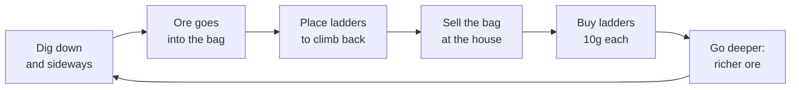

# Gameplay

How EternalDigger plays, and the numbers behind it. Every value here is a constant in the code; the identifier is
given so you can find and tune it. Positions are in **tiles** (column, row) unless they say cells. A tile is 4 × 2
console cells.

## The loop



There is no win or game-over state. The challenge is to go deep enough for valuable ore while keeping enough
ladders to get back up. If you get stuck anyway, the rescue brings you home at the price of your bag.

## The world

```text
row 0   ┐
 …      │ sky (air)                      house & shop: columns 2–11
row 9   ┘ ← the surface walk row         door: 3–6, shop counter: 8–11, spawn: 15
row 10    grass, unbreakable ─────────── except the shaft, column 21
row 11    first underground row          shaft rows 10–11 start dug out, with ladders
 …        act 1: dirt, stone, granite, copper, silver, gold, caves
110 m     the obsidian wall, 3–5 tiles thick: the shovel can't break it
 …        act 2: slate, quartzite, gems, caves
 ∞        (generated as you go)
columns 0 and 29 below the grass: bedrock, unbreakable
```

| Fact | Value | Identifier |
|---|---|---|
| Width | 30 columns, exactly the screen width. The camera only scrolls up and down | `Mine.Columns` |
| Surface | Row 10 is grass (depth 0). Rows above are sky | `Mine.SurfaceRow` |
| Depth | `row − 10` metres. The HUD shows at least 0 | `Mine.Depth` |
| Shaft | Column 21. The only way down, under the wooden `MINE` frame | `Mine.ShaftColumn` |
| Walls | Columns 0 and 29 below the surface are bedrock. Everything outside the 30 columns counts as bedrock too, so you can't walk off the screen | `Mine.At` |
| Endless | Rows are generated the first time anything touches them, 64 at a time | `Mine.RowsPerBlock` |
| Seed | Same seed, same mine, every time. Pass it as the first command-line argument | `Mine(int seed)`, `Program.cs` |

### What's down there

The mine is generated from the seed with a deterministic hash noise (`Mine.Noise`), so it doesn't need to be stored
before you dig it. Each underground tile is decided in this order (`Mine.Underground`):

1. **Gold** from 30 m (`Tiles.GoldDepth`), vein chance 2% growing to 6%.
2. **Silver** from 12 m (`Tiles.SilverDepth`), vein chance 4% growing to 8%.
3. **Copper** from 2 m (`Tiles.CopperDepth`), vein chance 8%.
4. **Cave** (air) from 6 m (`Tiles.CaveDepth`), rare small pockets.
5. **Rock** otherwise: granite from 40 m (`Tiles.GraniteDepth`), then stone, then dirt. The deeper, the more stone
   and granite.

Below 110 m (`Tiles.WallDepth`) the order changes (`Mine.BelowTheWall`, after the wall in that column):

1. **The wall:** obsidian from 110 m down to 112–114 m, a thickness of 3–5 tiles that varies per column
   (`Mine.WallBottomDepth`, `Tiles.WallMinThickness`/`WallMaxThickness`). Bedrock still frames it.
2. **Gem** veins, chance 4% growing to 7%.
3. **Cave** (air), rare small pockets.
4. **Rock:** quartzite (25% of the rock, growing to 50%), else slate.

None of the act 1 rock or ore appears below the wall.

Ore comes in **veins**: a coarse noise on 2 × 2 tile blocks decides where a vein is, and a fine noise leaves gaps in
it (`Mine.IsVein`). Rock is "blobby" the same way, half coarse, half fine noise.

| Tile | Hits to break | Worth |
|---|---|---|
| Dirt | 2 | — |
| Stone | 4 | — |
| Copper | 4 | 15g (`Tiles.CopperValue`) |
| Silver | 6 | 40g (`Tiles.SilverValue`) |
| Granite | 7 | — |
| Gold | 8 | 100g (`Tiles.GoldValue`) |
| Obsidian | the shovel can't break it: a clank, sparks and a red `TOO HARD` (at most once a second) | — |
| Slate | 6 | — |
| Quartzite | 8 | — |
| Gem | 9 | 250g (`Tiles.GemValue`) |

The resulting mix, **measured** over 200 seeds (share of tiles between the side walls, in %). The vein chances and
rock thresholds in the code compare against noise, so these shares are the best guide to what a player meets:

| Depth | Dirt | Stone | Granite | Copper | Silver | Gold | Cave |
|---|---|---|---|---|---|---|---|
| 1–5 m | 90 | 4 | — | 6 | — | — | — |
| 10–15 m | 78 | 11 | — | 8 | 3 | — | 0.6 |
| 20–25 m | 64 | 24 | — | 7 | 5 | — | 0.7 |
| 30–35 m | 43 | 41 | — | 7 | 6 | 2 | 0.6 |
| 40–45 m | 22 | 60 | 0.1 | 7 | 7 | 3 | 0.5 |
| 50–55 m | 5 | 75 | 3 | 7 | 7 | 4 | 0.7 |
| 60–65 m | 1 | 71 | 8 | 7 | 8 | 5 | 0.6 |
| 80–85 m | — | 51 | 29 | 7 | 7 | 6 | 0.6 |
| 100–105 m | — | 47 | 32 | 7 | 7 | 6 | 0.6 |

(The shares are for act 1; act 2 below the wall has not been measured yet.)

So: copper is everywhere from 2 m, silver becomes common below 20 m, gold appears at 30 m and levels off around
6% from 80 m. Dirt is gone below about 60 m, so everything there takes 4 or more hits.

**Toughness grows with depth:** every 25 m (`Tiles.DepthPerExtraHit`) adds one hit to every breakable tile. Dirt at
50 m needs 4 hits, gold at 100 m needs 12, a gem at 115 m needs 13 (`Tiles.HitsToBreak`).

The lift can't be built through the wall: its segments stop at 100 m while the obsidian in the shaft column stands
(the sign says ` LIFT BLOCKED BY OBSIDIAN `). Blasting the obsidian in column 21 lets it go deeper ([Dynamite](#dynamite)).

## The miner

The miner always occupies exactly one tile. Every move slides them one tile, and **no keys are read while a move
plays** (except `R`, the rescue).

| Move | Takes | Identifier |
|---|---|---|
| Walk one tile | 0.13 s, eased in and out | `MinerControlSystem.WalkDuration` |
| Climb or step down one tile | 0.17 s | `ClimbDuration` |
| Climb up, held | 0.17 s for the first 4 tiles, then faster over the next 10 down to 0.06 s per tile; a 100 m climb takes about 7.5 s. Letting go of Up, stepping off the ladder or anything else starts slow again | `ClimbRampStart`, `ClimbRampTiles`, `TopClimbDuration`, `ClimbUpDuration`, `Miner.ClimbStreak` |
| Fall one tile | 0.06 s, speeding up | `FallDuration` |
| One shovel hit | every 0.16 s while the key is held | `DigInterval` |

### Standing and falling

The miner stands still when **any** of these is true (`Mine.IsSupported`):

- their own tile has a ladder,
- the tile below is solid,
- the tile below has a ladder (they stand on top of it).

Otherwise they fall, one tile at a time, **before any key is read**. There is no fall damage. Landing kicks up dust,
and a fall of 3 or more rows shakes the screen.

### Each key, exactly

When the miner is idle and supported, keys are checked in this order every frame (`MinerControlSystem.Control`):

1. **`SPACE` (just pressed):** place a ladder in the miner's own tile.
2. **Left or right (held):** turn that way. If the side tile is air, walk into it. If it is solid and breakable, hit
   it. If it is grass, bedrock or outside the mine, nothing happens. Holding both cancels out.
3. **Down (held):** if the tile below is solid, hit it. If it is air, step into it; without a ladder there, the
   fall rule takes over.
4. **Up (held):** only while standing **in** a ladder tile. If the tile above is air, climb into it. If it is solid,
   hit it (so you can dig upwards from a ladder).

Every dig or move also turns the **headlamp** that way (`Miner.LampDirection`). The last tile you dug at or moved
towards is the one the lamp lights.

### Digging

Each hit adds one to the tile's `Damage`. The tile breaks on the hit that reaches its hits-to-break; it then becomes
air. Every hit throws debris out of the tile face, and cracks appear on the tile as it takes damage. Breaking a tile
bursts it into chunks and dust and shakes the screen a little. Breaking **ore** puts one piece in the bag
(`Shop.Collect`), with extra sparks. There is no bag limit.

### Ladders

`SPACE` places a ladder in the tile the miner stands in, using one from the inventory (`Mine.TryPlaceLadder`). It
only works when:

- you have at least one ladder,
- you are underground (row 11 or deeper; the surface and sky refuse ladders),
- the tile is air and has no ladder yet.

Ladders can't be picked up again. To climb up you need a ladder in **every** tile you climb out of: the up key only
works on a ladder tile, and the tile you arrive in must be a ladder tile too if you want to keep climbing.

> **Rule of thumb:** a straight shaft down to depth *d* needs *d* − 1 ladders (the shaft's top two tiles come with
> ladders). The 8 starting ladders get you back from 9 m. Side tunnels need no ladders.

Holding `↑` on a long ladder speeds the climb up after 4 tiles (see [the miner](#the-miner)).

A good habit: place a ladder, then dig the tile below. You stay on the ladder while you dig, step down into the new
hole, and repeat.

## The house

The house stands on the surface over columns 2–11. Stand still on the right spot and press `E`
(`InteractionSystem`). A framed prompt shows above the miner on these spots.

| Spot | Columns (row 9) | `E` does | Feedback |
|---|---|---|---|
| Door | 3–6 (`Layout.DeliverFirstColumn`…`DeliverLastColumn`) | Sells **everything** in the bag: copper 15g, silver 40g, gold 100g each (`Shop.Deliver`) | Coins burst and cascade onto the grass (one per 10g, 3 to 30 coins), a ring of stars, a floating `+<gold>g`. Empty bag: a small dust puff |
| Shop counter | 8–11 (`Layout.ShopFirstColumn`…`ShopLastColumn`) | Buys **one** of the selected item. `↑`/`↓` there choose the item (it wraps); ladders are selected first, so `E` alone buys a ladder (`ShopCounter`, `Shop.TryBuy`) | A ring of stars and a floating `-<price>g`. Not enough gold: a dust puff, and the price is red |

The counter sells (`ShopCounter.Items`, prices in `Shop`):

| Item | Price | Notes |
|---|---|---|
| Ladder | 10g | One per press |
| Fill lamp | 2g per missing unit | Fills the tank; `FULL` when it is ([Lamp oil](#lamp-oil)) |
| Shovel | 300 / 900 / 2500g | Each tier digs 15% faster ([Upgrades](#upgrades)) |
| Lamp | 250 / 750 / 2000g | Each tier: +2 tiles of reach and −20% oil burn |
| Bag | 200 / 600 / 1500g | Each tier: +10 weight carried before the climb slows (with bag weight) |
| Detector | 400 / 1200 / 3000g | Each tier: +3 tiles of glint radius, glints 20% more often |
| Blasting kit, then dynamite | 2500g once, then 100g a stick | The same slot: it sells the kit until you own it |

The panel above the miner shows ` ↑ <ITEM> ↓ `, what you have (`HAVE <n>`, or `UNLOCKS DYNAMITE` for the kit) and
`<price>g [E]` (`SOLD OUT` when it can't be bought any more). The `BLASTING` shed further right is scenery.

You start with 0 gold and 8 ladders (`Shop.StartGold`, `Shop.StartLadders`), standing at column 15 on the surface
(`Layout.SpawnColumn`).

<a id="lamp-oil"></a>
## Lamp oil

The headlamp burns oil (`LampOil.cs`, `Miner.Oil`, `LampSystem`). It never hurts the miner.

| What | Rule | Identifier |
|---|---|---|
| Tank | 100 units, full in a new mine (and in saves from before lamp oil) | `LampOil.TankSize` |
| Burning | 1 unit per 3 s, only underground (riding the lift too); ×0.8 per lamp tier. 100 units last 5 minutes with the starting lamp | `SecondsPerUnit`, `BurnRate`, `Upgrades.LampBurnPerTier` |
| Low (below 30 units) | The cone shortens with the oil, from the full reach down to 3 tiles; the lamp flickers (some 0.04–0.12 s stretches are one light level darker, more of them the emptier it gets); the lamp glyph turns dark yellow and grey `°` smoke rises from it every 0.45 s | `LowShare`, `LowReach`, `LampOil.Reach`, `Headlamp` |
| Empty | No cone: only the close radius, one level darker. The lamp glyph is dark grey, no glow dots. Remembered outlines and glints still show, so the way home can be found, or hold `R` | `LampOil.IsEmpty` |
| Refill | `FILL LAMP` at the counter: 2g per missing unit (`OIL <n>%` on the panel) | `LampOil.FillPrice`, `TryFill` |
| HUD | `OIL ▮▮▮▮▮▯▯▯` on row 0: white, yellow below half, blinking red when low | `HudSystem.OilCells` |

<a id="upgrades"></a>
## Upgrades

Four lines, three tiers each, bought at the counter (`Upgrades.cs`, tiers on the `Miner`). The panel shows tier pips
(`●●○`) and `MAX` at the top tier.

| Line | Per tier | At tier 3 | Identifier |
|---|---|---|---|
| Shovel | 15% less time between hits | 0.088 s instead of 0.16 s | `Upgrades.DigInterval`, `ShovelSpeedPerTier` |
| Lamp | +2 tiles of cone reach (the bright and lit bands scale with it: half and three quarters of the reach), oil burn ×0.8 | 14 tiles, ×0.51 burn | `Upgrades.LampReach`, `LampReachPerTier` |
| Bag | +10 weight before the climb slows | +30 | `BagCapacityPerTier` |
| Detector | +3 tiles of glint radius; samples 20% more often | 18 tiles, every 0.041 s | `Upgrades.GlintRadius`, `GlintInterval` |

On the miner: the shovel turns white, cyan, then yellow per tier; the lamp glyph turns white from lamp tier 2.

<a id="the-lift"></a>
## The lift

A lift (`Mining/Elevator.cs`) runs down the mine shaft (column 21), bought 10 m at a time at the `LIFT` sign beside
the mine entrance.

| What | Rule | Identifier |
|---|---|---|
| Buying | Stand at columns 23–24 on row 9 and press `E`. The first segment costs 200g, each next one 100g more (300g, 400g…). It digs out the next 10 shaft tiles; ore found there goes into the bag, ladders stay. Not enough gold: a dust puff, the prompt price is red | `Elevator.TryBuild`, `FirstSegmentPrice`, `SegmentPriceStep`, `SegmentMetres`, `Layout.IsAtLiftSign` |
| Landings | Two: the surface (row 9, above the shaft) and the bottom of the last segment (depth = 10 m × segments) | `Elevator.TopRow`, `BottomRow`, `IsLanding` |
| Calling / getting in | On a landing, `E` gets in if the car is there; otherwise it calls the car, and the miner gets in when it arrives | `InteractionSystem.Interact`, `ElevatorSystem.Carry` |
| Riding | In the stopped car: `↑` rides to the top, `↓` to the bottom, at 0.04 s per tile (100 m in about 4 s). No other key is read while it moves | `Elevator.RideDuration`, `MinerControlSystem.Control` |
| Getting out | `←`/`→` walks (or digs) off the car; `↓` at the bottom steps off and digs or climbs down. Deeper than the lift, ladders are needed as before | same |
| Feedback | `ELEVATOR +10m` floats up and stars pop over the sign on a purchase, which also saves. The HUD shows `LIFT <n>m` once built | `FloatingTextKind.Elevator`, `HudSystem` |

The shaft below the surface is open once the lift is built: stepping into it without a ladder or the car means a
fall to the bottom landing (no fall damage).

<a id="dynamite"></a>
## Dynamite

The way through the obsidian wall, and a fast but costly way to dig anywhere.

| What | Rule | Identifier |
|---|---|---|
| Buying | At the shop counter, the blasting slot: the kit once (2500g), then one stick per press (100g). Every purchase saves | `Shop.TryBuyBlasting`, `BlastingKitPrice`, `DynamitePrice` |
| Planting | Hold `E` for 0.5 s underground, standing still and not on a lift landing: a lit stick goes into the tile the lamp faces (the last move or dig direction). Needs the kit, a stick, and rock there (any breakable rock or obsidian). Otherwise a dust puff. While `E` is held the miner does nothing else; let go to plant the next one. The HUD shows a ` LIGHTING FUSE ` bar | `MinerControlSystem.UpdatePlanting`, `PlantDuration` |
| The fuse | 2 s, with yellow/red `*` sparks and grey `·` smoke | `FuseDuration`, `DynamiteSystem` |
| The blast | Clears the 3 × 3 tiles around the stick: any rock, obsidian included. Bedrock, the grass and the sky stay. Ore in it goes into the bag; ladders in it are destroyed; other sticks in it go off 0.12 s later | `DynamiteSystem.Blast`, `BlastRadius`, `ChainDelay` |
| The miner | Never hurt. Inside the blast area (and standing, not riding) he slides one tile away from the stick if that tile is open | `DynamiteSystem.Push`, `PushDuration` |
| Looks | One frame of white/yellow `█` over the area, a ring of 150 `▓▒░` rubble and 40 chunks, dust that lingers 1–2 s, the biggest screen shake. The miner stays drawn on top. A red `¡` on his belt while he carries sticks | `EffectSpawner.Blast`, `MinerRenderSystem` |

A 4-tile wall needs about 4–6 sticks. A stick in a lit fuse that is saved (sale, purchase, autosave, `ESC`) goes back
into the stock.

## The rescue

Hold `R` for 1.5 s (`MinerControlSystem.RescueDuration`) and the miner is pulled back to the spawn tile. It works
anywhere, even mid-move. The HUD shows a red progress bar while you hold it; letting go early resets it.

The price: **the bag is emptied**. Gold and ladders are kept. Underground with 0 ladders, the HUD blinks
`NO LADDERS LEFT!  Hold R to be rescued (the bag is lost)` as a reminder.

## Light and darkness

Underground it is dark. What you see comes from daylight near the surface and from the miner's headlamp
(`Rendering/LightMap.cs`). Each tile on screen gets one of four light levels every frame:

| Level | Looks like |
|---|---|
| `Bright` | Full colour: textured, filled background, metal specks in ore |
| `Lit` | The texture in colour on black |
| `Dim` | Dark shades only; ore specks in their darker colour |
| `Dark` | Black. If you saw the tile before, a faint grey outline **without ore colours** |

Where the light comes from:

| Source | Lights |
|---|---|
| Daylight | The sky and the grass row: `Bright`. Dug-out tiles right under the surface and the tiles touching them: `Lit` at 1 m, `Dim` at 2–3 m |
| Headlamp, close | Every tile within 1.5 tiles of the miner: `Bright`, rock included, so you always see the walls you dig at |
| Headlamp, cone | ±40° around `LampDirection`, up to 8 tiles: closer than 4 `Bright`, closer than 6 `Lit`, further `Dim`. **Solid tiles block the beam**: you only see into open tunnels and caves, and the first wall |

A tile that has been lit once is remembered (`TileCell.Seen`), so explored tunnels stay faintly visible.

### Finding ore: glints

Because rock blocks the lamp, ore inside the rock is found by its **glints**: ore within 9 tiles of the miner
twinkles now and then, through rock and in the dark (`GlintSystem`). Gold twinkles most often (90% per sample), silver
less (60%), copper least (40%), and ore in the dark twinkles more than lit ore. Watch for yellow, cyan and dark yellow
twinkles and dig towards them.

## The screen

| Part | Shows | Identifier |
|---|---|---|
| HUD, row 0 | ` ETERNAL DIGGER ` title, gold, ladders (`╟╢<n>`), `LIFT <n>m` once a lift is built, dynamite (`¡<n>`) once the kit is bought, the oil gauge, depth, the bag (copper/silver/gold/gem counts with coloured `◆` icons) and what the bag is worth | `HudSystem` |
| HUD, row 1 | The key help; the rescue bar while `R` is held; the ` LIGHTING FUSE ` bar while `E` is held to plant; the no-ladders warning. After a save, ` SAVED ` at the right end for 1.5 s (grey, then dark grey), or ` SAVE FAILED` in red | `HudSystem` |
| Title screen | `ETERNAL DIGGER` logo, `CONTINUE` / `NEW MINE` (selected item black on yellow with `►`), the confirmation, a red message for an unreadable save, `↑↓ choose   E select   ESC quit` | `TitleScene`, `TitleMenu` |
| Camera | Keeps the miner at 40% of the screen height, eased. Never scrolls above the sky. Shakes on breaks and long falls | `CameraSystem` |
| Prompts | ` DELIVER [E] ` / the shop counter's three-line panel / ` BUILD LIFT +10m [E] <price>g ` / ` CALL LIFT [E] ` / ` GET IN [E] ` / ` ↑↓ RIDE   ←→ GET OUT ` / ` LIFT BLOCKED BY OBSIDIAN ` in a small bobbing frame above the miner | `PromptRenderSystem` |

## Tuning cheat sheet

| To change… | Edit |
|---|---|
| Ore values, depths, toughness, the wall's depth and thickness, the hint depth | `Mining/Tiles.cs` |
| How common ore, caves and rock are | `Mine.Underground` (act 1) and `Mine.BelowTheWall` (act 2) in `Mining/Mine.cs` |
| Ladder price, starting gold and ladders | `Shop.cs` |
| Lift prices, segment length, ride speed | constants at the top of `Mining/Elevator.cs` |
| Kit and dynamite prices | `Shop.cs` |
| Tank, burn rate, low point, refill price | `LampOil.cs` |
| Upgrade prices and effects | `Upgrades.cs` |
| Plant time, fuse length | `MinerControlSystem.PlantDuration`, `FuseDuration` |
| Blast size, chain delay, push | constants at the top of `Systems/DynamiteSystem.cs` |
| Move speeds, the climb ramp, dig speed, rescue time | constants at the top of `Systems/MinerControlSystem.cs` |
| Lamp range and cone | constants at the top of `Rendering/LightMap.cs` |
| Glint and mist rates | `Systems/GlintSystem.cs`, `Systems/MistSystem.cs` |
| Where the house, door, shop and spawn are | `Layout.cs` |
| Autosave interval underground | `GameSaver.AutosaveInterval` in `Saving/GameSaver.cs` |
| How long ` SAVED ` shows | `HudSystem.SavedHintSeconds` |
| Particles drawn around the miner | `ParticleRenderSystem.NearMinerCap` |

Tests pin many of these numbers (`Examples/EternalDigger.Tests`), so update them with the change. See
[testing.md](testing.md).

<a id="saving"></a>
## Saving

The game saves itself; there is no save key.

- **When:** after every sale at the door (when it earned gold) and every ladder bought, every 60 s spent underground
  (`GameSaver.AutosaveInterval`), and on `ESC`, which saves and quits. A NEW MINE is saved as soon as it starts.
- **What:** the seed, the miner's tile and facing, gold, ladders and the bag, the lift (segments and the car's
  landing), the blasting kit and the dynamite stock (lit sticks counted back in), the upgrade tiers, the lamp oil, and every tile that differs from what
  the seed generates (dug, half-dug, ladder placed, seen). The mine itself is regenerated from the seed.
- **Not saved:** anything mid-action. A continued game starts with the miner standing still on the saved tile (if
  that tile has no support, they fall), no particles, and the rescue timer at zero.
- **Title screen:** `CONTINUE` loads the save. `NEW MINE` uses the seed from the command line (or a random one); with
  a save it asks `Start over? The saved mine will be lost.` with `NO` selected first. `ESC` on the title quits
  without saving.
- **Unreadable save** (damaged, or a format version this build doesn't know): the title shows a red message and only
  `NEW MINE`; the file is moved to `save.dat.bad` so it isn't overwritten.
- **Where:** `EternalDigger/save.dat` in the user's local app-data folder (`SaveFile.DefaultPath`). The file is written
  to `save.dat.tmp` and then moved over the old one, so a crash mid-save keeps the previous save.

<a id="known-limitations"></a>
## Known limitations

- **Not played by hand yet.** The game has been run in a macOS terminal and its frames checked, and the rules are
  covered by frame-by-frame tests, but nobody has played it with a real keyboard or in the Windows console.
- **Holding keys in a terminal** relies on the engine's terminal input handling (key auto-repeat on macOS/Linux), so
  walking and digging can feel less smooth there than on Windows.
- **One save slot.** Starting a NEW MINE replaces it (after a confirmation).
- **No goal, no danger.** There is no win condition, no fall damage, no bag limit and no time pressure.
- **Ladders are permanent** once placed.
- **Shake at the edges:** while the screen shakes sideways, the outermost one or two columns underground can flash
  black for a moment, because the terrain is drawn only for the mine's 30 columns.
- The door prompt shows even when the bag is empty; pressing `E` then only gives a dust puff.
