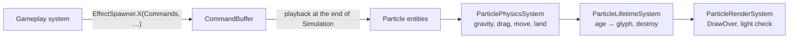

# Rendering and effects

How a frame of EternalDigger gets onto the screen: the `Canvas` every renderer draws through, the light map, how
tiles, the house and the miner are drawn, and the particle pipeline behind every effect.

## Draw order

The Presentation group draws in `Add` order, each layer over the last:

| # | System | Draws | Covers |
|---|---|---|---|
| 1 | `SkyRenderSystem` | Sky gradient, sun, clouds, hills | Every screen cell above the grass |
| 2 | `TerrainRenderSystem` | Every tile from the grass row down, by light level | Every screen cell from the grass down (the mine's 30 columns) |
| 3 | `HouseRenderSystem` | House, sign, chimney smoke, ladder shop, `MINE` frame | Fixed spots on the surface |
| 4 | `MinerRenderSystem` | The 4 × 2 miner and the lamp glow | Over the world |
| 5 | `ParticleRenderSystem` | Every particle glyph | Over the world, keeping its background |
| 6 | `FloatingNumberRenderSystem` | `+150g` / `-10g` | Over everything so far |
| 7 | `PromptRenderSystem` | `DELIVER [E]` / `BUY LADDERS [E] 10g` | Above the miner |
| 8 | `HudSystem` | The two top rows | Screen rows 0–1 |

Layers 1 and 2 together paint every cell of the screen each frame. That matters for the `Canvas`.

## Canvas: drawing without black boxes

The engine's `RenderConsole.Draw(x, y, char, fg, bg)` always sets the background. A glint over a gold tile, debris
in front of the house or a coin against the sky would each punch a black (or wrongly coloured) box into the scene,
and the engine has no public way to read a cell's colour back.

`Rendering/Canvas.cs` wraps the `RenderConsole` and keeps one `ConsoleColor[]` the size of the screen:

| Method | Does |
|---|---|
| `Draw(x, y, char, fg, bg)` | Draws and records `bg` for the cell. Clips to the screen |
| `Draw(x, y, ReadOnlySpan<char>, fg, bg)` | The same for text |
| `DrawOver(x, y, char, fg)` | Draws a character with the background **already recorded** at that cell |
| `BackgroundAt(x, y)` | The last background drawn there (black off-screen) |

Because the sky and the terrain cover every cell each frame, the recorded backgrounds are always this frame's. Rule
for new code: **world layers use `Draw`, things drawn on top use `DrawOver`.**

## Light

`Rendering/LightMap.cs` holds one byte per tile for the rows on screen. `LightingSystem` recomputes it every frame,
right after the camera moved, from the miner's sliding `Position` (so the light glides along with them) and
`Miner.LampDirection`.

```text
for each tile on screen
  level = max(daylight(tile), lamp(tile))
  if level > Dark: mark the tile Seen

daylight: depth ≤ 0 → Bright
          depth 1–3 and dug out (or touching a dug-out tile) → Lit at 1 m, Dim at 2–3 m
lamp:     distance ≤ 1.5 tiles → Bright (walls included)
          outside ±40° of the lamp direction, or beyond 8 tiles → Dark
          a solid tile on the line between lamp and tile → Dark
          distance < 4 → Bright, < 6 → Lit, else Dim
```

The "solid tile on the line" test samples the ray 4 times per tile (`RaySamplesPerTile`) and skips the lamp's own
tile and the target. It runs only for tiles inside the cone and range, so a frame costs a few thousand tile lookups.

Other systems use the light map too: `ParticleRenderSystem` hides dust and mist in the dark, `MistSystem` only spawns
mist in lit tiles, and `GlintSystem` makes ore in the dark glint more.

## Terrain

`TerrainRenderSystem` draws the tile rows from `max(SurfaceRow, first row on screen)` to the bottom of the screen,
all 30 columns, cell by cell. Looks come from `Rendering/TileLooks.cs`: one `TileLook` per `TileType` with a texture
string, colours for full and dim light, and for ores a speck character (`◆`) and its colours.

| Light | Character | Foreground | Background |
|---|---|---|---|
| `Bright` | Texture, or a speck (40% of an ore tile's cells) | `Foreground`, or `SpeckColor` | `Background` (filled) |
| `Lit` | Texture or speck | `DimColor`, or `SpeckColor` | Black |
| `Dim` | `░`, or a speck | `DimColor`, or `DimSpeckColor` | Black |
| `Dark`, seen before | `░` on most cells | Dark grey | Black |
| `Dark`, never seen | Space | — | Black |

- **No flicker:** which texture character, which cells are specks and which crack are picked with `Mine.Noise` on
  the cell's world position (salts `TextureSalt`, `SpeckSalt`, `CrackSalt`), so they're the same every frame.
- **Cracks:** a damaged tile replaces up to 8 cells with `/`, `\`, `╳` or `x`, in proportion to `Damage` over its
  hits to break. Black on a filled tile, grey on black. Cracks don't show in the dark.
- **Dark tiles never show ore:** remembered rock is a plain grey outline. Ore is found by glints.
- **Air:** black. In `Lit` or `Bright` light, about 12% of cells get a faint `·`, the cave's back wall.
- **Ladders:** `╟──╢` on both rows of the tile, yellow in bright light, dark yellow when lit or dim, dark grey when
  dark but seen.
- **Grass row:** green `▀` tufts (`▓` here and there) over a sunny soil row. Always drawn as daylight. The shaft
  tile in that row is drawn like any dug-out tile with a ladder.

## Sky and surface

`SkyRenderSystem` fills every screen cell above world y = 20 (`SkyHeight`, the grass row):

- **Gradient:** blue down to world y = 4, a dithered `▒░` band at y = 5, cyan below (`SkyColor`).
- **Hills:** dark green, 1–5 cells high from two sine waves (`HillHeight`), with a `▄` rim against the sky.
- **Sun:** a 4 × 2 yellow block at (98, 3).
- **Clouds:** three white clouds drifting right at 1.5–2.4 cells/s, wrapping around the screen, hidden behind the
  hills.

`HouseRenderSystem` draws the buildings from rectangles in world cells, based on the `Layout` constants:

| Part | Where (world cells) | Look |
|---|---|---|
| Roof | 5-row wedge over x 8–31 | Red and dark red `▀▄` shingles |
| Chimney and smoke | x 25–26 | Grey; four `○`/`°` puffs rising and swaying |
| Walls | x 9–31, 8 rows above the grass | Dark yellow planks, `─` every other row |
| Sign | Centred under the eaves | ` EternalDigger ` in yellow on dark red |
| Windows | Left and right of the door | `┌┬┐` / `└┴┘` on cyan |
| Door | Over the deliver columns (x 18–21) | `║` boards and a yellow `•` knob |
| Shop | x 32–47 | Red/white striped awning, black window with `╟─╢` ladders on display, counter, `LADDERS` |
| Mine frame | Around the shaft (x 83–88) | `╔════╗` beam on `║` posts, a `MINE` plank |

## The miner

`MinerRenderSystem` draws 4 × 2 cells at the sliding `Position`, mirrored by `FacingX`. Cells are counted from the
miner's back:

| Row | Back → front |
|---|---|
| Top | (empty), `▄` backpack, `☻` head, the lamp: `•`, or `▲`/`▼` when it points up/down |
| Bottom | (empty), `▐` overalls, legs, shovel |

Legs: `█` standing, `▙`/`▟` alternating while walking, `╫` climbing, `╨` falling. The shovel is `/` (or `\` facing
left) at rest; mid-swing it is `│` for up/down digs, or `─` then a tilt for side digs. Underground, two dots (`∙`
`·`) glow in front of the lamp. All miner cells use `DrawOver`, so the sky or the tunnel shows around the sprite.

## Particles

All effects are entities with the engine's `Position`, `Velocity` and `Glyph`, plus:

- `Particle`: `Age`, `Lifetime`, `Style` (`ParticleStyle`) and a random `Variant` byte;
- `Physics`: `Gravity` (cells/s², positive is down) and `Drag` (share of speed lost per second);
- optionally the tag `TileCollider` (lands on rock) or `Mist` (counted by `MistSystem`).

### Pipeline



- **`EffectSpawner`** (`Effects/EffectSpawner.cs`) is the only place that creates particles. Every method takes the
  calling system's `Commands`, so it is safe to call from inside a query loop.
- **`ParticlePhysicsSystem`:** `v.y += gravity·dt`, `v *= 1 − drag·dt`, `p += v·dt`. Particles with `TileCollider`
  that move into a solid tile: from above, they land on top and stop (faster than 8 cells/s down they bounce once at
  35% speed and lose 40% sideways speed); from the side, they lose their sideways speed and keep falling; anything
  else (a ceiling) stops them where they were.
- **`ParticleLifetimeSystem`:** ages each particle and rewrites its `Glyph` from `ParticleLooks.Character` and
  `ParticleLooks.Color` for its `Progress` (age / lifetime); destroys it at the end of its life.
- **`ParticleRenderSystem`:** draws each glyph with `Canvas.DrawOver`. Dust and mist are skipped on `Dark` tiles;
  debris, sparks, coins and glints show everywhere.

### Looks over a lifetime (`Effects/ParticleLooks.cs`)

| Style | Characters, birth → death | Colour |
|---|---|---|
| `Dirt`, `Stone`, `Granite`, `Copper`, `Silver`, `Gold` (debris) | `■ ▪ ▪ ·` (variant shifts it) | The tile's colours, e.g. gold yellow → dark yellow |
| `Dust` | `▓ ▒ ░ ░ ·` | Grey, then dark grey |
| `Spark` | `* + ·` | Yellow, then dark yellow |
| `Glint` | `· + ✦ ✦ + ·` | White at the peak; yellow (gold), cyan (silver), dark yellow (copper) at the ends |
| `Mist` | One of `· ∙ · · ˙` | Dark grey |
| `Coin` | Spins `● ◐ \| ◑` | Yellow, dark yellow on the edge frame |
| `Pop` | `✶ * + ·` | White, then dark yellow |

### Effects catalogue

| Effect | Triggered by | What spawns |
|---|---|---|
| `DigHit` | Every shovel hit (`MinerControlSystem`) | 4–7 debris chunks from the struck face, flying back towards the miner and falling (gravity 40, lands on rock), 0.5–1.1 s. Ore adds 2–4 sparks |
| `TileBreak` | The hit that breaks a tile | 14–22 chunks bursting out, 6–10 dust puffs drifting up, screen shake 0.6 (rock) or 0.9 (ore). Ore adds 6–10 glitter sparks |
| `FootDust` | Every other walking step, every climb step, a placed ladder, a refused `E`/`SPACE` | 1–2 small puffs behind the feet |
| `LandingDust` | The end of a fall; a rescue | 2 + 2 per row fallen (max 12) puffs to both sides; falls of 3+ rows shake the screen (0.15 per row, max 1.2) |
| `Glint` | `GlintSystem`: every 0.08 s, 6 random tiles within 9 tiles of the miner and on screen; ore glints with 90/60/40% (gold/silver/copper), 60% of that when lit | One twinkle, 0.5–0.8 s, no gravity |
| `Mist` | `MistSystem`: while fewer than 40 exist, up to 12 per second, in a random lit air tile below the surface | One slow drifting dot, 4–8 s |
| `Coins` | A delivery (`InteractionSystem`): one coin per 10g, 3 to 30 | Coins shoot up and rain onto the grass (gravity 45, bounce once), spinning, 1.6–2.4 s |
| `Pop` | A delivery, a purchase, a rescue | A ring of 8–12 stars, 0.35–0.5 s |
| `Number` | A delivery (`+<gold>g`), a purchase (`-10g`) | Text drifting up and slowing, 1.4 s, fading after 70% |

### Screen shake

`ScreenShake` holds one `Strength` in cells: effects `Add` to it (capped at 2), `CameraSystem` offsets the camera by
a random amount up to the strength in both directions and decays it by 6 per second.

## Text: numbers, prompts, HUD

- **`FloatingNumberRenderSystem`** formats `+123g` or `-10g` into a reused `char[16]` with `int.TryFormat`, so a
  number allocates nothing per frame. Positive yellow, negative red, darker for the last 30% of its life.
- **`PromptRenderSystem`** draws a three-row box (`┌─┐ │ │ └─┘`, yellow on dark blue) with the text, a `▼` pointer
  just above the miner's head, and a small bob. `[E]` is yellow. The text strings are `PromptRenderSystem.DeliverText`
  and `BuyText`.
- **`HudSystem`** fills rows 0–1. The status line is a string rebuilt **only when a shown value changes** (gold,
  ladders, depth, the three ore counts); the `◆` icons are coloured by position. Row 1 is the key help, the rescue
  bar (24 cells) or the blinking no-ladders warning.

## Known rendering quirks

- **First frame of a particle:** particles are created at the end of the Simulation group, after the lifetime step
  set glyphs, so in their first drawn frame they show the glyph `EffectSpawner` gave them: dust, sparks, stars and
  glints start as a space (the cell's character is blanked for one frame), and debris starts as a dark yellow `■`
  whatever its style. Fix by creating each `Glyph` from `ParticleLooks` at progress 0.
- **Edge columns while shaking:** the terrain is drawn only for the mine's 30 columns, so a sideways shake can leave
  the outermost one or two screen columns black for a moment underground.
